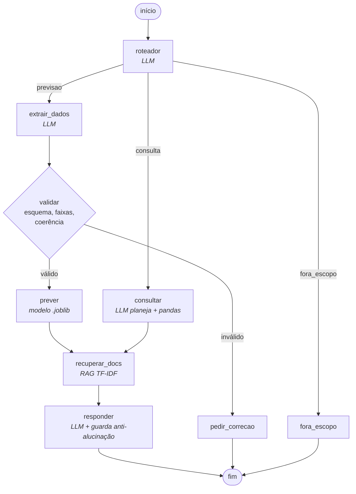

# Agente de IA — Churn de clientes Telco (N2, 2º bimestre)

Trabalho da disciplina de Inteligência Artificial (EC09) — Prof. Marcones Cleber Brito da Silva.

Agente construído com **LangGraph** que recebe uma pergunta em linguagem natural, **interpreta** o pedido com um LLM, **consulta o modelo de churn treinado na avaliação anterior** (carregado do disco) e responde em português, fundamentado apenas nos resultados das ferramentas e no [cartão do modelo](docs/cartao_modelo.md).

> **Escopo definido pelo grupo:** o agente usa somente a base tabular **Telco Customer Churn** (sem a CNN de imagens). Pedidos de análise de imagem são reconhecidos pelo roteador e recusados como fora do escopo.

O que o agente faz:
- **Prever** se um cliente vai cancelar — pelo `customerID` (busca na base) ou pelos atributos descritos em texto livre.
- **Simular "e se"** — ex.: "e se ele tivesse contrato de dois anos?" (reaproveita os dados do turno anterior).
- **Consultar** a base (taxa de churn, contagens e médias, com filtros e agrupamentos) e a documentação do modelo (métricas e limitações).
- **Pedir correção** quando a entrada não segue o esquema do dataset, e **recusar** pedidos fora do escopo.

---

## 1. Arquitetura



Diagrama gerado automaticamente pelo LangGraph: [`docs/grafo_agente.mmd`](docs/grafo_agente.mmd) (`python scripts/exportar_grafo.py`).

### Estado (`agente/estado.py`)
`EstadoAgente` é um `TypedDict`. Os campos de dados do cliente ficam salvos no checkpoint da conversa (memória), o que permite corrigir dados e fazer simulações nos turnos seguintes.

| Campo | Conteúdo |
|---|---|
| `pergunta`, `historico` | mensagem do turno e histórico da conversa |
| `rota`, `justificativaRota` | decisão do roteador |
| `dadosCliente`, `idCliente`, `clienteDaBase` | dados de entrada (acumulados entre turnos) e cliente encontrado na base |
| `valido`, `errosValidacao`, `camposFaltando`, `camposPreenchidosPorCoerencia` | resultado da validação |
| `resultadoFerramentas`, `trechosDocumentacao` | saídas das ferramentas e trechos recuperados do cartão/dicionário |
| `resposta`, `guardaAcionada`, `nosVisitados` | resposta final, se a guarda descartou o texto do LLM, nós visitados |

### Nós e papel do LLM

| Nó | Usa LLM? | O que faz |
|---|---|---|
| `roteador` | **sim** (saída estruturada `DecisaoRota`) | classifica em `previsao`, `consulta` ou `fora_escopo` |
| `extrair_dados` | **sim** (saída estruturada `DadosExtraidos`) | transforma o texto em campos do dataset; um regex garante a captura do `customerID` |
| `validar` | não | colunas obrigatórias, tipos, faixas da base e coerência entre campos |
| `pedir_correcao` | não | lista erros/campos faltantes com os valores aceitos |
| `prever` | não | carrega `Modelos/modelo_tabular.joblib`, devolve classe e probabilidade + taxas históricas das categorias do cliente |
| `consultar` | **sim** (planeja `PlanoConsulta`) | a consulta é executada em pandas; se o plano for inválido, o LLM recebe o erro e tenta de novo uma vez |
| `recuperar_docs` | não | RAG por TF-IDF em `docs/cartao_modelo.md` e `docs/dicionario_dados.md` |
| `responder` | **sim** | redige a interpretação; classe e probabilidade são escritas por código, não pelo LLM |
| `fora_escopo` | não | mensagem padrão explicando o que o agente faz |

### Garantias contra previsões inventadas
1. O LLM nunca calcula nada: classe, probabilidade, taxas e métricas vêm das ferramentas ou do cartão do modelo.
2. O cabeçalho da previsão é montado por código a partir da saída do modelo.
3. **Guarda anti-alucinação** (`nos_auxiliares.encontrarNumerosSemFonte`): todo número citado pelo LLM é comparado com os números dos resultados e da documentação (aceitando arredondamento e proporção ↔ porcentagem). Se houver número sem fonte, o texto do LLM é descartado e substituído por uma resposta determinística — o campo `guardaAcionada` registra isso.

### Elementos adicionais implementados
- **Memória de conversa** (checkpoint `MemorySaver` por `thread_id`): correções em vários turnos e simulações "e se".
- **RAG** sobre a documentação do dataset e do modelo.
- **Interface Gradio** com painel mostrando rota, nós visitados e resultados das ferramentas.

---

## 2. Como executar

```bash
python -m venv .venv
source .venv/bin/activate            # Windows: .venv\Scripts\activate
pip install -r requirements.txt
cp .env.example .env                 # escolha o provedor do LLM
```
(Windows: `copy .env.example .env`)

**LLM** — escolha um no `.env`:
- Local, sem chave: instale o [Ollama](https://ollama.com), rode `ollama pull qwen2.5:7b` e use `LLM_PROVIDER=ollama`.
- API: `LLM_PROVIDER=groq` (ou `openai` / `google`) e a chave correspondente **no `.env`** (nunca no código).

> O `requirements.txt` fixa `scikit-learn==1.6.1`: o modelo foi salvo no Colab com essa versão e não abre em versões mais novas.

**Modelo salvo** — `Modelos/modelo_tabular.joblib` é o arquivo original exportado pelo notebook no Colab. Para conferir que ele reproduz o resultado do notebook (sem retreinar) e regerar as métricas usadas pelo agente:
```bash
python scripts/avaliar_modelo.py
```

**Usar o agente**
```bash
python app_gradio.py                                  # interface web (demonstração)
python main.py                                        # chat no terminal
python main.py --mostrar-estado "Qual a chance do cliente 7590-VHVEG cancelar?"
```

**Testes**
```bash
pytest -q                          # testes automáticos sem LLM (validação, ferramentas, guarda, arestas)
python testes/rodar_bateria.py     # bateria com o LLM real -> testes/resultados_bateria.md e .csv
python scripts/exportar_grafo.py   # diagrama do grafo
```

---

## 3. Testes e avaliação

[`testes/casos_teste.json`](testes/casos_teste.json) tem **14 casos**, cada um com rota esperada e desfecho esperado. O script registra rota obtida, desfecho obtido, se a ferramenta devolveu o valor correto, se a guarda foi acionada, tempo e a resposta completa.

| Categoria | Casos | O que testa |
|---|---|---|
| Tabular | T01–T04 | busca por ID, cliente descrito em texto livre, preenchimento por coerência, simulação "e se" |
| Consulta | T05–T07 | estatística com filtro, pergunta sobre o modelo (RAG), estatística agrupada |
| Inválido | T08–T10 | valores fora da faixa/categoria inexistente, ID inexistente, dados incompletos |
| Memória | T11 | pedido de correção e complemento no turno seguinte |
| Fora do escopo | T12–T13 | conhecimento geral, pedido de classificação de imagem |
| Adversarial | T14 | tentativa de forçar uma probabilidade inventada |

Resultados: [`testes/resultados_bateria.md`](testes/resultados_bateria.md) (gerado pela execução real; inclui a taxa de roteamento correto e a seção de análise das falhas).

## 4. Logs
Cada nó grava uma linha em `logs/execucoes.jsonl` (thread, nó, duração, entrada/saída resumidas, erros). Opcionalmente, defina `LANGSMITH_TRACING=true` e `LANGSMITH_API_KEY` no `.env` para traces no LangSmith.

## 5. Documentação
- [Cartão do modelo](docs/cartao_modelo.md) — classes, métricas, motivo da escolha, limitações e riscos.
- [Dicionário de dados](docs/dicionario_dados.md) — variáveis, valores aceitos e regras de validação.
- [Log de uso de IA](LOG_USO_IA.md).

## 6. Estrutura

```
agente/            estado, esquema/validação, ferramentas, nós, grafo, LLM, logs
                   (*_constantes.py: constantes de cada módulo; *_auxiliares.py: funções auxiliares)
docs/              cartão do modelo, dicionário de dados (base do RAG), grafo exportado
Modelos/          modelo_tabular.joblib (Colab), telco_churn_features.py, métricas
dados/            Telco Customer Churn.csv (busca por customerID e consultas)
scripts/          avaliar_modelo.py, exportar_grafo.py
testes/            casos, bateria com LLM real, testes pytest
agentNotebook.ipynb        primeiro protótipo (carregar o modelo e prever um cliente)
main.py, app_gradio.py     interfaces
```

---

## Avaliação anterior (N2, 1º bimestre) — treino do modelo

O notebook [`Telco_Customer_Churn.ipynb`](https://github.com/Lucas-O-S/Modelos_Classificat-rios_IA_N2/blob/main/Telco_Customer_Churn.ipynb), no repositório [Modelos_Classificat-rios_IA_N2](https://github.com/Lucas-O-S/Modelos_Classificat-rios_IA_N2), percorre o pipeline completo: limpeza (correção de `TotalCharges`), EDA (fibra óptica × suporte técnico), split estratificado 80/20, atributos derivados (`serviceQuantity`, `fibra_sem_suporte`), 6 classificadores, comparação de conjuntos de atributos e análise de custo dos erros (FN = R$ 10.000, FP = R$ 100). O **Naive Bayes** teve o menor custo total e foi o modelo salvo e usado pelo agente. Métricas detalhadas no [cartão do modelo](docs/cartao_modelo.md); relatório completo em [`RelatorioSemImagens`](https://github.com/Lucas-O-S/Modelos_Classificat-rios_IA_N2/blob/main/RelatorioSemImagens).

## Autores
- Adriana Kaori Kakazu — 082220004
- Beatriz dos Santos Buglio — 082220028
- Lucas Oliveira Silva — 082220019
- Vitoria Kaori Kuriyama — 082220005
